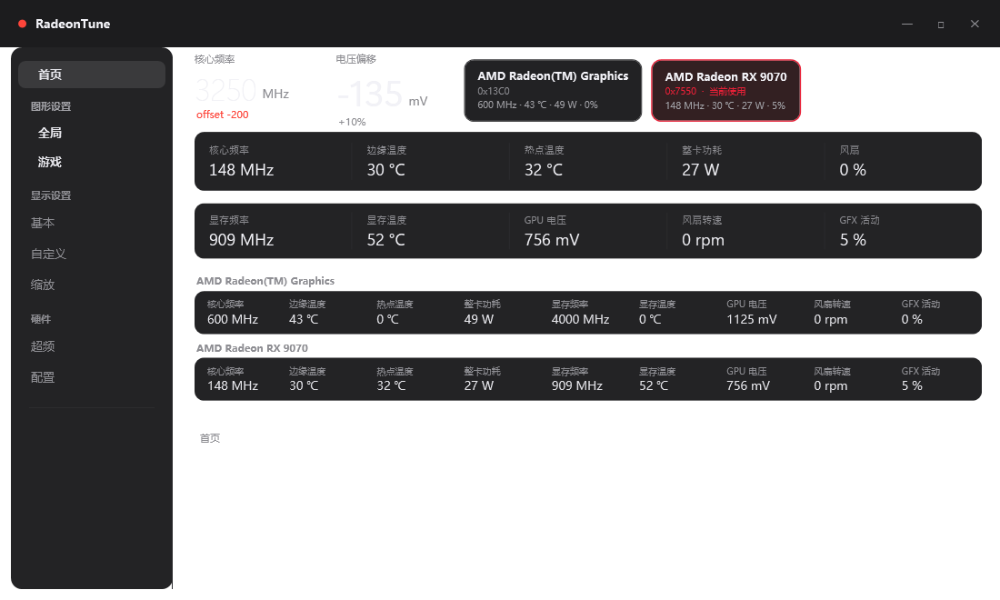

# RadeonTune

**English** | [简体中文](README.zh-CN.md)

**A lightweight tuning & monitoring panel for AMD Radeon GPUs (RDNA4 / RX 9070 tested), built on ADLX/ADL.**

RadeonTune is a compact WPF (.NET 8) control panel for AMD Radeon graphics cards. It talks to the driver
through a small native core (`rt_core.dll`, ADLX/ADL) and exposes the same controls the vendor panel has, without its shell/WebView stack —
overclocking offsets, fan curve, display modes, 3D feature switches, and live multi-GPU monitoring.
None of these are secret switches: they are the same controls the vendor panel offers — the difference is
that they live in a normal desktop app instead of a shell-hosted WebView.



## Why this exists

RadeonTune is **not** an overclocking toy — it is a replacement for the vendor's driver control panel,
because that panel is unreliable by construction:

- It is a **browser-based front end hosted inside Explorer**. When Explorer restarts, hangs, or the
  WebView stack misbehaves, the panel disappears, goes blank, or refuses to reopen.
- Its **overclocking presets are stored by the driver's own mechanism**, and that storage gets
  silently overwritten or cleared — after driver updates, profile reloads, or when the panel itself
  re-initialises. Tuned values simply vanish.

RadeonTune avoids both failure modes (see [docs/design-notes.md](docs/design-notes.md) for the full
analysis and what is observed vs. inferred): a small native core (`rt_core.dll`) talks to ADLX/ADL directly,
the UI is plain WPF with no WebView and no Explorer dependency, and presets live in your own files
(`data\presets.json`, `data\settings.json`) that nothing else rewrites.

## What it deliberately does not do

**No VRAM overclocking, no memory voltage or timing tuning.** A memory clock change on these GPUs
forces a UCLK switch, and combined with the driver's anti-droop (LLC) regulation that is a classic
source of display-link instability (black/white screens).

**This is a known AMD issue, unfixed from RDNA3 through RDNA4:** a memory overclock passes stress tests
and then drops the display at idle ↔ load transitions. The driver exposes no load-line / droop control, so
it cannot be corrected from user space — which is why the feature is absent rather than unfinished.
See [docs/design-notes.md](docs/design-notes.md) for the full reasoning and the status of each claim.

## Recommended setup

Install the AMD driver with the **"Driver Only"** option (skip the bundled control panel). You get the
kernel driver and ADLX, but not the unstable WebView panel — RadeonTune provides the controls you
actually use, and the machine stays free of the panel's Explorer coupling.

## Features

- **Live monitoring** — core/VRAM clock, edge & hotspot temperature, VRAM temperature, board power,
  GPU voltage, fan RPM, GFX activity. One full panel per GPU; multi-GPU systems show every card.
- **Multi-GPU** — pick the active card with one click; the choice is remembered. Monitoring of idle
  cards can be disabled to keep CPU package C-states intact.
- **Overclocking** — core clock limit, power limit, voltage offset, 5-point fan curve, zero-RPM,
  save/apply presets, apply-at-startup, one-click revert.
- **Display** — resolution & refresh rate switching with a 15-second confirm/rollback guard,
  color depth, pixel format, GPU scaling, VSR, custom resolutions.
- **3D / graphics** — Anti-Lag, Boost, Chill, Enhanced Sync, FRTC, RSR upscaling & sharpness,
  Image Sharpening 2, FSR upscaling / frame generation, AFMF switches.
- **Profiles** — global and per-game profiles, process-based auto-apply, cover art.
- **Quality of life** — tray icon (always resident), close-to-tray with rememberable choice,
  start with Windows (with configurable delay), single instance, Chinese/English UI.

## Install

### Installer (recommended)

1. Download `RadeonTune-Setup-1.2.6.exe` and run it.
2. The installer is per-user (no admin), adds Start Menu / Desktop shortcuts and an uninstall entry.
3. It installs to `%LOCALAPPDATA%\Programs\RadeonTune`, creates Start Menu / Desktop shortcuts and an
   uninstall entry (Apps & Features). No admin rights required.
4. To remove: run `uninstall.ps1` from the install folder, or use Apps & Features.

### Portable

1. Download `RadeonTune-v1.2.6-portable-win-x64.zip` and extract anywhere.
2. Run `RadeonTune.exe`. Settings live in `data\settings.json` next to the executable.

Requirements: Windows 10/11 x64, an AMD Radeon GPU with a recent Adrenalin driver.
Self-contained build — no .NET runtime installation needed.

## Usage notes

- Overclocking writes go through ADLX; values are validated against driver limits. Use at your own risk.
- Display mode changes show a confirmation dialog and roll back automatically after 15 s.
- Multi-GPU: the selected card is used for tuning pages; monitoring can cover all cards.
- Language can be switched at any time in **Profiles → Language**.

## Build from source

```
dotnet publish RadeonTune/RadeonTune.csproj -c Release -r win-x64 --self-contained true `
  -p:PublishSingleFile=false -o RadeonTune/dist
```

The native core `rt_core.dll` is built from `RadeonTune/native/rt_core.cpp` with mingw-w64
(ADLX SDK headers required and not bundled):

```
g++ -std=c++17 -O2 -shared -static -I <ADLX>/Include -I <ADLX>/ADLXHelper/Windows/Cpp `
  RadeonTune/native/rt_core.cpp <ADLX>/ADLXHelper.cpp adlx_shim.cpp -o rt_core.dll -ladvapi32
```

## Status

Early but functional. Verified on Radeon RX 9070 (Navi 48) + iGPU. Other RDNA2/3 cards should work
through the same ADLX interfaces but are untested.

## License

MIT — see [LICENSE](LICENSE).
