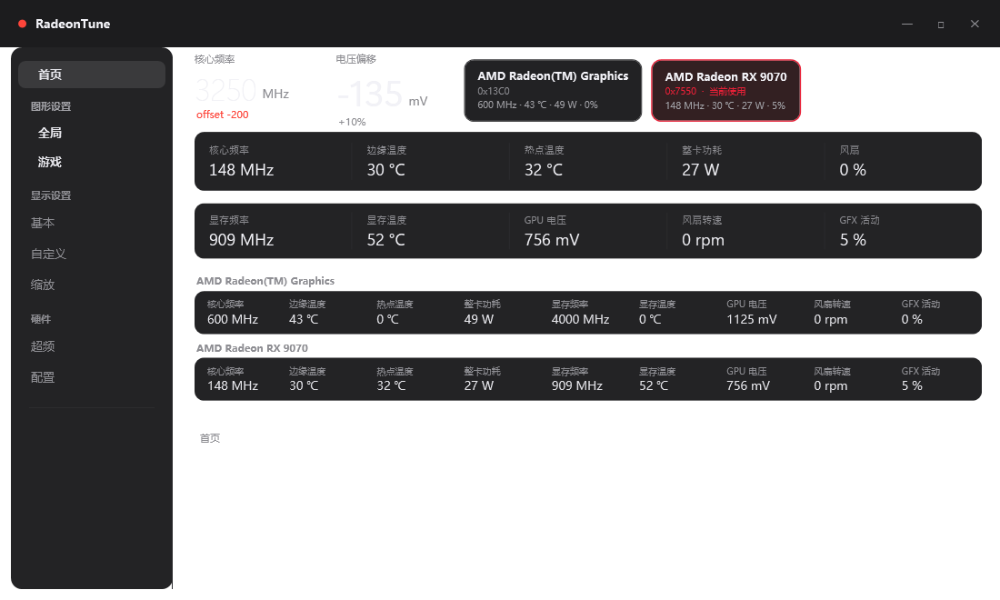

# RadeonTune

[English](README.md) | **简体中文**

**面向 AMD Radeon 显卡（RDNA4 / 已在 RX 9070 验证）的轻量调优与监控面板，基于 ADLX/ADL。**

RadeonTune 是一个紧凑的 WPF（.NET 8）控制面板，通过原生核心 `rt_core.dll`（ADLX/ADL）直接与驱动交互，
把官方软件里藏得较深的设置集中到一处：超频偏移、风扇曲线、显示模式、3D 功能开关，以及多卡实时监控。



## 功能

- **实时监控** —— 核心/显存频率、边缘与热点温度、显存温度、整卡功耗、GPU 电压、风扇转速、GFX 活动；
  每张显卡一块完整面板，多卡系统会同时展示所有卡。
- **多显卡** —— 一键切换当前操作的显卡并记住选择；可关闭空闲卡的轮询，避免影响 CPU 包级 C-state。
- **超频** —— 核心频率上限、功耗上限、电压偏移、5 点风扇曲线、低温零转速、预设保存与应用、
  开机自动应用、一键回退。
- **显示** —— 分辨率与刷新率切换（15 秒确认/自动回滚保护）、位深、像素格式、GPU 缩放、VSR、自定义分辨率。
- **图形设置** —— Anti-Lag、Boost、Chill、Enhanced Sync、FRTC、RSR 超分与锐化、Image Sharpening 2、
  FSR 超分/帧生成、AFMF 开关。
- **配置** —— 全局与单游戏配置、按进程自动应用、封面图。
- **易用性** —— 托盘常驻、关闭到托盘并可记住选择、开机自启（可设延迟）、单实例、中英文界面。

## 安装

### 安装版（推荐）

1. 下载 `RadeonTune-Setup-1.2.6.exe` 直接运行；
2. 安装到当前用户（无需管理员），自动创建开始菜单/桌面快捷方式与卸载项；
3. 安装到 `%LOCALAPPDATA%\Programs\RadeonTune`，创建开始菜单/桌面快捷方式与卸载项，无需管理员权限；
4. 卸载：运行安装目录里的 `uninstall.ps1`，或在“应用和功能”里卸载。

### 便携版

1. 下载 `RadeonTune-v1.2.6-portable-win-x64.zip` 解压到任意目录；
2. 运行 `RadeonTune.exe`，配置保存在同目录 `data\settings.json`。

环境要求：Windows 10/11 x64、AMD Radeon 显卡 + 较新的 Adrenalin 驱动。自带运行时，无需另装 .NET。

## 使用说明

- 超频写入走 ADLX，并按驱动上限校验；请自行承担风险。
- 切换显示模式会弹出确认框，15 秒内不确认自动回滚。
- 多显卡：调优页作用于所选显卡；监控可覆盖全部显卡。
- 语言可在 **配置 → 语言** 中随时切换。

## 从源码构建

```
dotnet publish RadeonTune/RadeonTune.csproj -c Release -r win-x64 --self-contained true `
  -p:PublishSingleFile=false -o RadeonTune/dist
```

原生核心 `rt_core.dll` 由 `RadeonTune/native/rt_core.cpp` 用 mingw-w64 编译（需要 ADLX SDK 头文件，仓库未附带）：

```
g++ -std=c++17 -O2 -shared -static -I <ADLX>/Include -I <ADLX>/ADLXHelper/Windows/Cpp `
  RadeonTune/native/rt_core.cpp <ADLX>/ADLXHelper.cpp adlx_shim.cpp -o rt_core.dll -ladvapi32
```

## 状态

早期但可用。已在 Radeon RX 9070（Navi 48）+ 核显上验证；其他 RDNA2/3 显卡理论上走同一套 ADLX 接口，
但尚未实机验证。

## 许可证

MIT，见 [LICENSE](LICENSE)。
